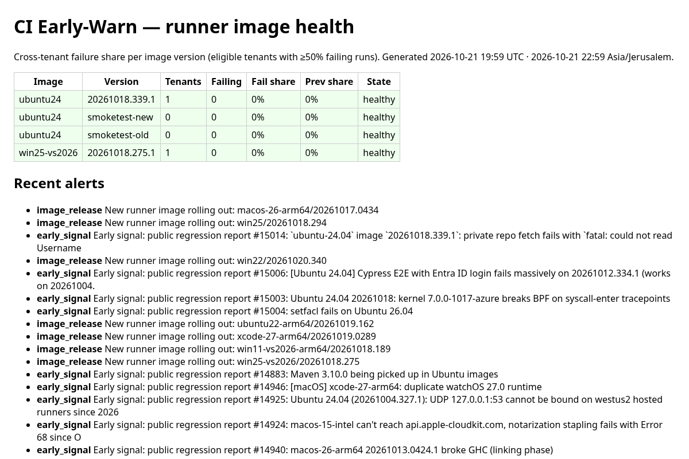

# CI Early-Warn

**Know when a new GitHub runner image is breaking builds across many repos, not just yours.**

[](LICENSE)
[](https://github.com/kobima6813/ci-earlywarn/releases)
[](https://collector-production-5b85.up.railway.app/)
[](https://github.com/kobima6813/ci-earlywarn/stargazers)



*Screenshot of the live status page (21 Oct 2026). The network is new, so tenant counts are still small; alerts include real image rollouts and public regression reports from actions/runner-images.*

**Quick start:** add one last step to a job: `- {if: always(), uses: kobima6813/ci-earlywarn/action/js@v0.2.1, with: {...}}` ([3-line install](#install-3-lines)).

**Why:** when `ubuntu-latest` or `macos-*` gets a new image and your build goes red, you lose hours deciding whether it's your code or the image. If several independent repos break on the same new image version, that's the answer. CI Early-Warn sends one anonymized beacon per job (image, version, pass/fail, failure category; no repo names, logs or code) and flags image versions where failures jump.

Live status: https://collector-production-5b85.up.railway.app/ · API: `/v1/status`, `/v1/alerts`. Opt-in, anonymized, MIT.

## Free CI cost audit

Want to know where your GitHub Actions minutes go? Email your workflow file(s) (`.github/workflows/*.yml`) to [conformance@mail.grokbot.com](mailto:conformance@mail.grokbot.com?subject=CI%20audit) with the subject **"CI audit"**. A screenshot of your Actions usage page is optional, but it helps.

You get back a short report on likely wasted runner minutes, with concrete fixes: concurrency cancel for superseded runs, path filters, matrix size, caching, artifact retention and runner size.

- Only the workflow YAML is needed. Please send no secrets and no source code.
- Reply within 2 business days.
- Your files are deleted after 30 days.

## Install (3 lines)
```bash
curl -s -X POST https://collector-production-5b85.up.railway.app/v1/signup   # -> {"token": "ewt_..."}; save as repo secret EW_TOKEN
# add `permissions: {actions: read, id-token: write}` to your workflow, then as the LAST step of a job:
- {if: always(), uses: kobima6813/ci-earlywarn/action/js@v0.2.1, with: {endpoint: "https://collector-production-5b85.up.railway.app/v1/beacon", token: "${{ secrets.EW_TOKEN }}", job-status: "${{ job.status }}"}}
```
A full example is in `examples/smoke.yml`.


Neutral cross-tenant early warning for GitHub-hosted runner-image regressions.

## Did the ubuntu-latest → 26.04 migration break my build?

GitHub is moving `ubuntu-latest` from 24.04 to 26.04 gradually, between Oct 19 and Nov 19, 2026 ([changelog](https://github.blog/changelog/2026-09-17-ubuntu-26-generally-available-and-latest-migration/), [runner-images#14748](https://github.com/actions/runner-images/issues/14748)). Quick check:

1. **Which image ran?** Failed run → *Set up job* → *Runner Image* (or `echo "$ImageOS $ImageVersion"`). Compare with the last green run.
2. **Pin and re-run:** `runs-on: ubuntu-24.04`. Green on 24.04 and red on 26.04 means it's the image.
3. **Diff the software:** [Ubuntu2404-Readme](https://github.com/actions/runner-images/blob/main/images/ubuntu/Ubuntu2404-Readme.md) vs [Ubuntu2604-Readme](https://github.com/actions/runner-images/blob/main/images/ubuntu/Ubuntu2604-Readme.md). Defaults move (Python 3.12→3.14, Node 22→24, OpenSSL 3.0→3.5, Clang 16–18→20–22); some tools are no longer listed (e.g. Java 8, Julia, Miniconda, Pulumi, Mercurial).
4. **Fix:** install/pin what you depend on (`setup-python`, `setup-node`, `setup-java`, explicit `apt-get`), add the OS version to cache keys, and test with a `[ubuntu-24.04, ubuntu-26.04]` matrix.

CI Early-Warn adds the cross-repo view: whether failures jump on a new `ImageVersion` across many repos, not just yours.

## Components
- `action/` – opt-in composite GitHub Action (`action.yml` + `beacon.py`, stdlib only). Add as the LAST step of a job:
  ```yaml
  - uses: kobima6813/ci-earlywarn/action@v0.2.1   # composite fallback (needs python3 on the runner)
    if: always()
    with:
      endpoint: ${{ vars.EW_ENDPOINT }}
      tenant-salt: ${{ secrets.EW_SALT }}
      job-status: ${{ job.status }}
      failed-step: ""          # optional; only a category is sent
  ```
  Sends: salted org hash, RUNNER_OS, ImageOS, ImageVersion, job conclusion, failing-step category, optional toolchain major.minor versions, timestamp. Never fails the job.
- `collector/app.py` – stdlib HTTP API + SQLite: `POST /v1/beacon`, `GET /v1/status`, `GET /v1/alerts`, `GET /` status page, `/healthz`. Strict schema (unknown fields rejected, 2 KB body cap).
- `collector/detector.py` – flags image version N when, versus N-1 of the same ImageOS: ≥5 tenants seen, ≥3 failing tenants (≥50% failing runs), failing-tenant share +15 pts and ≥2× previous. Thresholds configurable.
- `collector/alerts.py` – Slack-compatible webhook (only if `EW_WEBHOOK_URL` set), email-ready JSON.
- `collector/bootstrap.py` – zero-customer signal: polls public runner-images releases + new "Is it regression? Yes" issues (unauthenticated).
- `replay.py` – r108 backtest timings through the real detector. `demo.py` – 20-tenant end-to-end demo over HTTP.

## Run
```
python3 -m unittest -v tests/test_all.py
python3 demo.py        # writes out/status.html, out/demo_alerts.json
python3 replay.py      # writes out/replay.json
EW_DB=data/earlywarn.db python3 -m collector.app   # localhost:8787
```

## v0.2 hardening (local only)
- `POST /v1/signup` → per-tenant `ewt_` token (hash-only storage, signup rate-limited per IP). Beacons require `Authorization: Bearer`; the server assigns the tenant id (client `tenant` ignored).
- Rate limits: per IP and per token (token bucket) → 429.
- Sybil resistance: only *eligible* tenants count toward wave thresholds: ≥7 days old (`EW_MIN_TENANT_AGE_DAYS`) or verified by a GitHub Actions OIDC token (`X-GitHub-OIDC` header, aud `ci-earlywarn`, RS256 vs GitHub JWKS, stdlib RSA). Verified tokens of the same GitHub owner collapse to one tenant. Set `EW_OWNER_SALT` in prod (verification refused without it when `PORT` is set).
- Retention: `python3 -m collector.retention` (default 90 days, `EW_RETENTION_DAYS`).
- JS action `action/js` (node20, no deps): finds the failed step via `GET /repos/{repo}/actions/runs/{id}/attempts/{n}/jobs` with read-only `GITHUB_TOKEN`, categorizes locally, attaches OIDC if `id-token: write`. Composite action kept as fallback (now accepts `token`).
```yaml
permissions: {actions: read, id-token: write}
steps:
  - if: always()
    uses: ./action/js
    with: {endpoint: "https://<collector>/v1/beacon", token: "${{ secrets.EW_TOKEN }}", job-status: "${{ job.status }}"}
```
- Status page shows UTC and Asia/Jerusalem (`EW_TZ`). Drafts: TERMS_DRAFT.md, DPA_DRAFT.md.

## FAQ (hard questions, honest answers)

**How do you tell a runner-image regression from a popular action breaking?**
Opt in with `report-actions: "true"`: the beacon then sends a 16-hex hash of each `uses:` ref (`owner/repo@version`) in the job; names are never sent. For a flagged image version the collector picks the action hash shared by most failing tenants and compares strata: the same action version on the *old* image, and runs on the *new* image *without* that action version. Old image passes with it / new image fails without it → image. It fails on other images, or new-image runs without it pass → action.

**What if an action release lands the same day as an image bump?**
If some tenants are pinned (old action on the new image, or new action still on the old image) the strata above separate the two. If every failing tenant took both at once, no run isolates either cause, and the alert says **`ambiguous`** ("confounded") instead of guessing. Re-running one failing job on the previous image or action version settles it.

**What data is sent?** Server-assigned tenant id (from your token), RUNNER_OS, ImageOS, ImageVersion, job conclusion, a failing-step *category* (install/build/test/…, the step name stays local), optional toolchain major.minor, optional action-ref hashes, timestamp. No code, logs, repo names or secrets. Unknown fields are rejected, and bodies are capped at 2 KB. Beacons are deleted after 90 days.

**Are the action hashes private?** Partly. The salt is public, so anyone can hash a *known* public action and check for it. Private action names aren't exposed unless someone already knows them. That's why it is opt-in (default off).

**False positives with few tenants / cold start?** Nothing is flagged below ≥5 tenants on the new version and ≥3 failing tenants, plus a +15 pt and ≥2× jump vs. the previous version. Until the network is big, alerts will be rare. Meanwhile `collector/bootstrap.py` watches public runner-images releases and "regression" issues.

**Flaky tests and matrix jobs?** A tenant counts as failing only if ≥50% of its runs on that version fail, and the signal is the cross-tenant *share* vs the previous image, so one flaky repo doesn't move it. Matrix legs are separate beacons from the same tenant and count as one tenant.

**Self-hosted runners?** Not covered. They have no ImageOS/ImageVersion, so the JS action sends nothing there and logs why.

**Can someone poison it with fake beacons?** Tenants need a token, rate limits apply per IP (IPv6 /48) and per token, and only *eligible* tenants count toward thresholds: ≥7 days old, or verified with a GitHub OIDC token. Verified tokens of the same GitHub owner collapse into one tenant. A determined attacker with many real, aged GitHub orgs could still add noise. Alerts say "suspected" for that reason.

**Latency?** The detector runs on every beacon. Once thresholds are met, the next beacon flags it, typically within hours of an image rollout reaching enough tenants.

**Cost / does it slow my CI or fail my job?** It's free. One HTTPS POST at the end of the job (~1 s), never fails the job, no dependencies.

**How do I get alerts?** Public status page `/`, JSON `/v1/status` and `/v1/alerts`, Slack-compatible webhook on self-hosted collectors (`EW_WEBHOOK_URL`). Per-tenant email/Slack subscriptions aren't built yet.

---

If this saved you a "is it me or the image?" afternoon, a ⭐ helps other teams find it, and more tenants make the warnings better.
